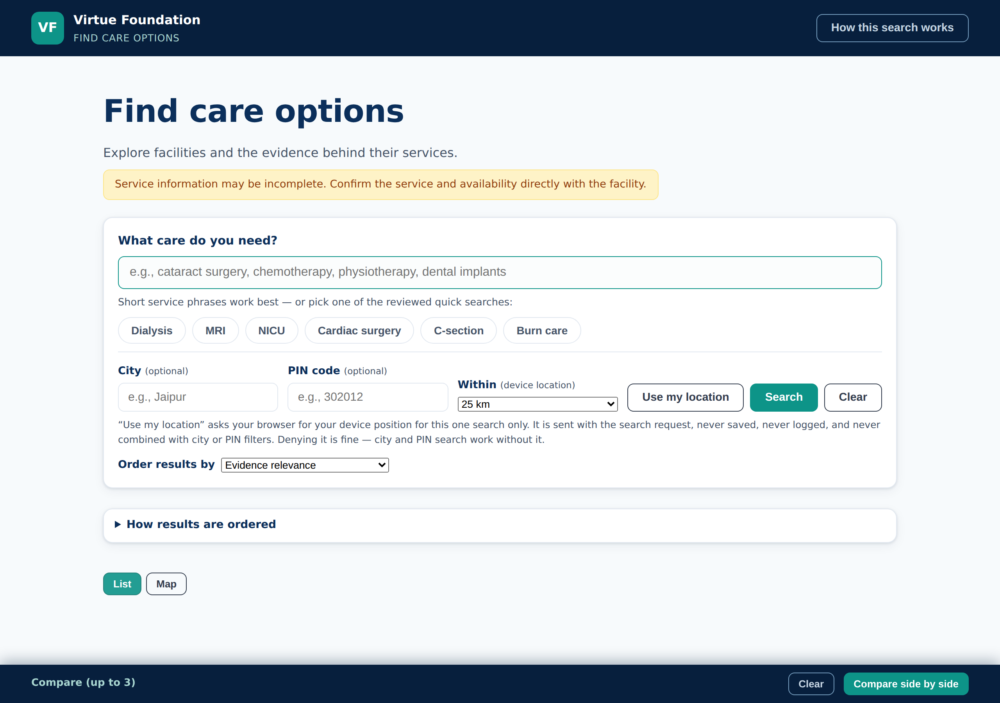
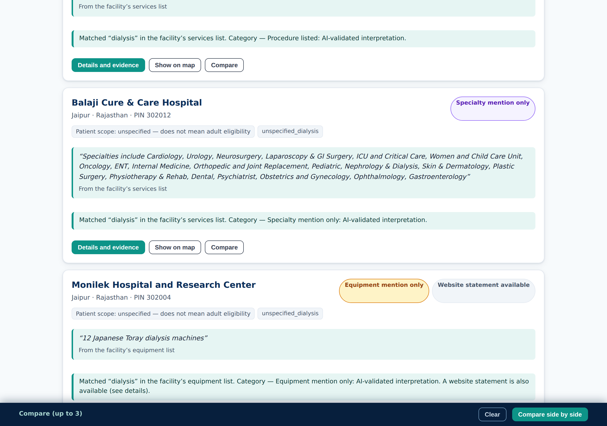
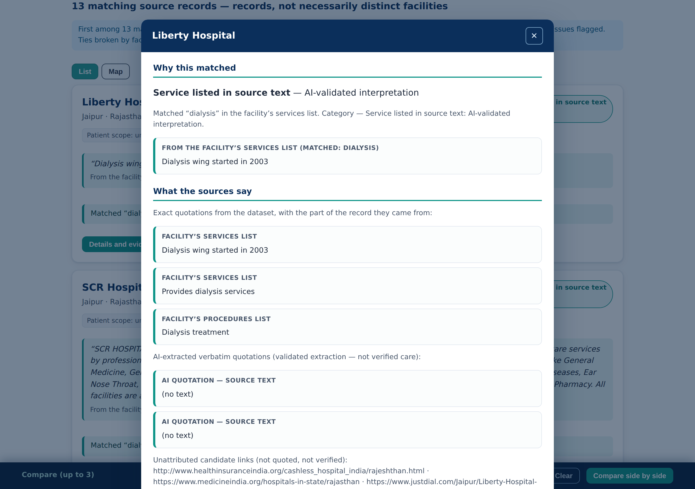
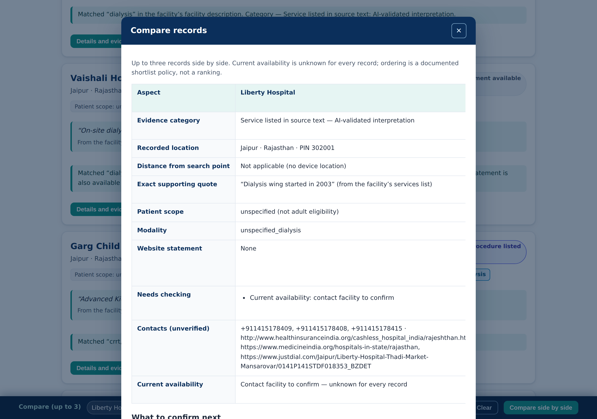
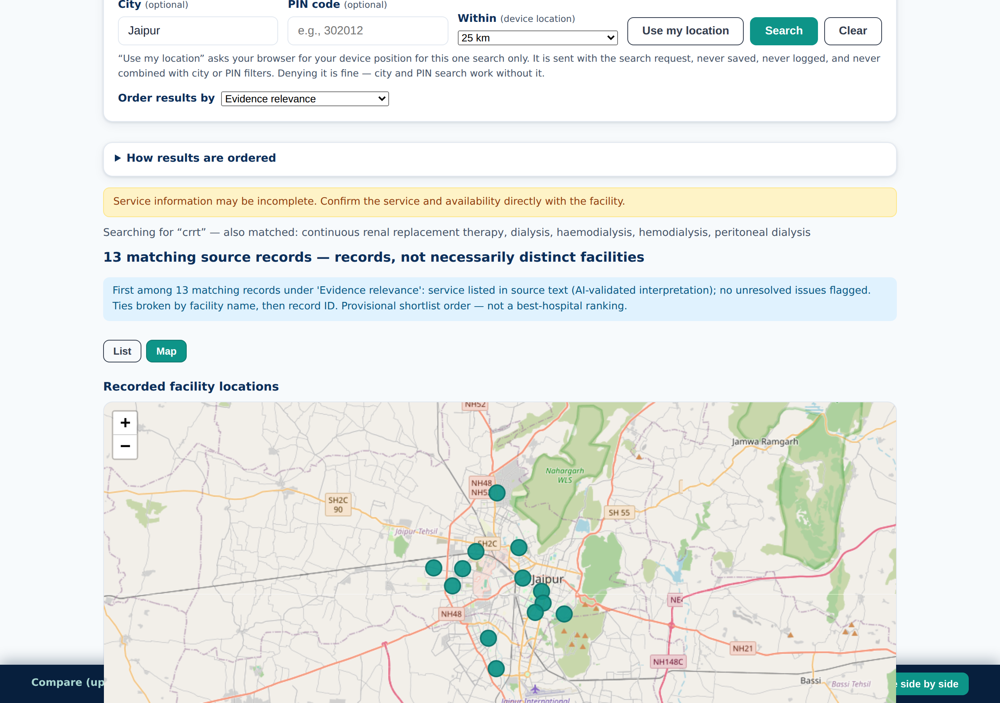
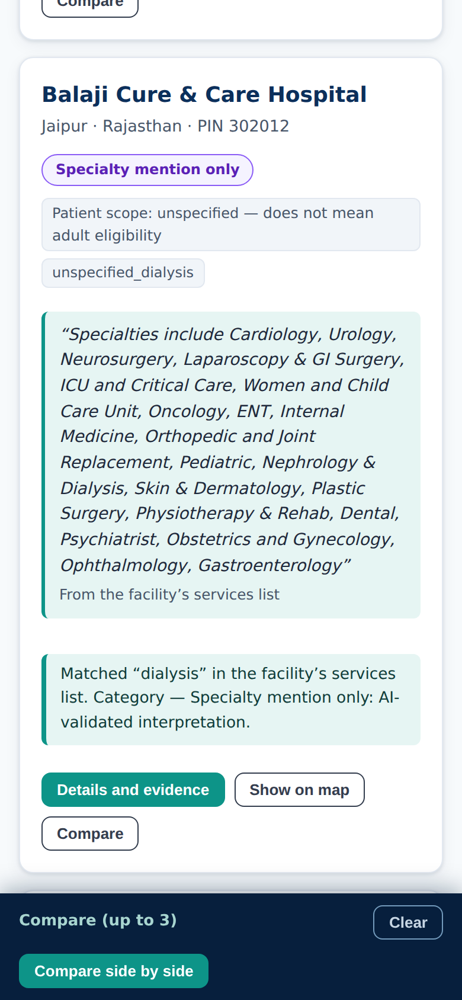

# Virtue Foundation Facility Finder

An evidence-backed facility finder for NGO coordinators and healthcare planners: search care-service mentions across the Virtue Foundation national facility dataset, understand exactly why each record appears, compare facilities side by side, and see results on an interactive map — before investigating or contacting facilities.

The app never claims "best hospital", confirmed availability, or clinical suitability. Every result explains **why it appears** and **how the system decided**.

Live deployment (Databricks App — requires Databricks sign-in with access to this workspace):
https://virtue-facility-finder-7474659425200889.aws.databricksapps.com

## Screenshots

Captured from the running application (search: `CRRT` + city filter `Jaipur` — 13 matching source records, live Unity Catalog data).

**Home** — care search with quick-search chips, optional city/PIN filters, and the honest-caveat banners shown throughout:



**Evidence-first search results** — every card shows the matched quotation, its source field, the evidence category, and the shortlist explanation:



**Evidence drawer** — exact source quotations with provenance, AI-interpretation status, unverified-contact caveats, "what still needs checking", and how this result was ordered:



**Side-by-side comparison** — up to 3 facilities, with explicit "not recorded" placeholders:



**Interactive map** — Leaflet 1.9.4 with OpenStreetMap tiles; markers are recorded (never independently verified) coordinates for the page's records:



**Mobile layout:**



## User-facing features

- **Search:** six quick-search service buttons (dialysis, MRI, NICU, cardiac surgery, C-section, burn care) plus free-text care phrases (e.g. `cataract surgery`), with optional city and PIN-code text filters. One result per source record, with aggregated evidence.
- **Evidence-first ordering (default):** a documented, deterministic provisional shortlist policy computed over the complete result set **before** pagination — never a medical ranking. Alternative sorts: facility name, or straight-line distance.
- **Distance search:** optionally share your device location (browser geolocation, explicit consent) with a chosen radius (0.5–500 km). Coordinates travel **only in the POST request body** — never in a URL — and are never logged or persisted. Location and city/PIN filters are mutually exclusive.
- **Side-by-side comparison:** select up to 3 facilities from result cards; a tray tracks selections across pagination, and a modal compares name, location, distance, contact provenance, availability, evidence quality, patient scope, and dialysis interpretation, with explicit "not recorded" placeholders instead of misleading blanks.
- **Interactive map:** Leaflet 1.9.4 (BSD-2-Clause, self-hosted — no CDN, no build step) with OpenStreetMap raster tiles (open data, ODbL). Markers plot the records' real recorded coordinates (never independently verified), distinguish compared facilities, show the search radius circle around a shared device location, and expose popups with evidence category and straight-line distance. If basemap tiles cannot load, an explicit notice appears — there is never a silent schematic fallback.
- **Evidence drawer:** per-record detail with source-field provenance, exact evidence quotations, review flags, contact notes ("Unverified — copied from source"), and dialysis AI-interpretation status with limitations.
- **Accessibility & mobile:** skip link, ARIA roles/labels, keyboard-reachable controls, focus management, responsive layout.
- **Built-in self-test:** the served app exposes `/selftest.html` — browser checks covering chips, a live search, evidence rendering, the comparison flow, and a live basemap-tile load check.

## Architecture

- **Backend:** FastAPI (`app.py`, `server/`) — parameterized SQL (named `:parameters` only) over Unity Catalog views via DBSQL, using the Databricks App's managed identity. No tokens in code; credentials are resolved at request time. A non-fatal startup self-test exercises the real connector and logs a summary to app logs. Errors never fall back to mock data.
- **Frontend:** no-build static HTML/CSS/JS (`frontend/`) served from the same origin — same-origin `/api/*` fetches only, no CDN dependencies, Leaflet vendored locally.
- **Deployment:** Databricks Apps V2 (`app.yaml` — uvicorn; `DATABRICKS_WAREHOUSE_ID` env; SQL warehouse `CAN_USE` resource).

## API contract

`GET /api/health` → `{"status": "ok"}`

`GET /api/facilities/services` → `{services: [{code, label}...], note}`

`GET /api/facilities/search?q=<care phrase>|service=<code>&city=<text>&pin=<text>&page=<1..>&page_size=<1..100>&sort=evidence|name`

`POST /api/facilities/search` — same engine and filters as GET, plus an optional device origin for distance search (`origin: {lat, lng, accuracy_m}`, `radius_km`) and `sort=distance`. Precise coordinates are accepted only in the POST body, used solely for the requested search, never logged or persisted, and never combined silently with city/PIN (that combination is rejected with 400).

- Provide **either** `q` (free-text care phrase) **or** `service` (legacy code, translated server-side to its canonical care phrase and run through the SAME token-boundary engine). Supplying both or neither → 400. Invalid service code → 400.
- **One matching engine** for typed phrases and quick-search buttons: token-boundary phrase match of the normalized query (or an audited orthographic alias, e.g. `physiotherapy` / `physical therapy`) within a single evidence element — fragments are never combined across fields. Input is treated as literal text (never regex/SQL), bounded to 120 chars / 8 words. Conversational sentences ("I need the best...") → 400 with a suggestion to try a shorter care phrase. No model calls or embeddings.
- **Alias rules (audited):** `mri`/`nicu` abbreviations require token boundaries (full-name equivalents included); cardiac surgery requires surgical context; `cardiac surgeon`-style matches are labeled `specialist_mention` — a named specialist is not proof surgery is performed onsite; verified `Caesarian` spelling variants and explicit burn-surgery phrases are included; modifiers like `pediatric` are preserved in every expanded alias.
- **Ordering:** `evidence` (default — documented shortlist policy over the full result set before pagination), `name`, or `distance` (requires an origin). Ties broken deterministically.
- **Dialysis AI interpretation and Jaipur pilot evidence** attach only when the interpreted query maps unambiguously to the dialysis service family; other free-text results carry explicit `null` enrichment and a stated limitation.
- **Response:** `{total_count, page, page_size, query: {interpreted, aliases_used, ...}, ordering: {rules, first_result_explanation, exclusions?}, results: [...]}`. Each result: `record_id`, `facility_name`, `location {city, state, pincode, latitude, longitude, coordinate_status}`, `sql_evidence {items[{source_field, evidence_text, matched_terms}], count, matched_terms}`, `ordering {category_label, category_detail, distance_km?, unresolved_reasons}`, `ai_enrichment_status`, `ai_interpretation{...} | null`, `jaipur_pilot_supplement{...} | null`, `contacts {phones, websites, note, branch_warning}` — contacts are copied from source data and always labeled unverified.
- Unusable coordinates (missing/invalid, outside India's bounding rectangle, known location conflict) are excluded from distance search and map markers, and counted in `ordering.exclusions`.

## Authentication & privacy

The Databricks Apps gateway enforces Databricks OAuth for both the page and the API. The frontend uses same-origin `/api/*` fetches, which ride the authenticated browser session — no tokens or PATs in browser code. Cross-origin access is not supported. Device location, when explicitly shared, is sent only in the POST body, used for the one requested search, and never logged or persisted.

## Data sources (read-only)

- `vf.app.vw_facility_search_documents` — narrow app-facing view over the persisted free-text search index `vf.search.facility_search_documents_v1` (built once from `vf.silver.facilities_current_v1` — 579,335 normalized text elements covering 9,997 of 10,077 records)
- `vf.app.vw_facilities_public` — narrow public record view (name, city, state, pincode, review flags)
- `vf.app.vw_facilities_coordinates` — recorded coordinates with coordinate status (used for distance search and map markers)
- `vf.app.vw_facilities_contacts` — contact provenance
- `vf.gold.facility_service_mentions_v2` — national record/service pairs, including validated dialysis AI enrichments
- `vf.gold.dialysis_jaipur_pilot_v2` — Jaipur dialysis pilot supplement (retrieved website evidence, 1:1 join)

The app's service principal is granted SELECT only on the narrow `vf.app` views and the `vf.gold` tables it needs — never on internal silver/search tables beyond the exposed views.

A **complete export** of every table above (Parquet, row-count-verified, dated 2026-11-22) is included in [`data/`](data/README.md) so the dataset can be inspected and analyzed without workspace access. The live app still reads Unity Catalog at runtime.

## Project layout

```
virtue-facility-finder/
  app.py            # FastAPI app: API routes, static frontend mount, startup self-test
  app.yaml          # Databricks App config (command, env, SQL warehouse resource)
  requirements.txt
  README.md
  server/
    config.py       # managed-identity / local auth, warehouse + host resolution
    sql.py           # DBSQL wrapper with named :parameters
    facilities.py    # token-boundary matching engine, ordering, distance, enrichment
  frontend/
    index.html      # no-build shell
    styles.css      # design system (local, no CDN)
    app.js          # search, drawer, comparison, map, pagination
    leaflet.js/.css # Leaflet 1.9.4 (BSD-2-Clause), vendored
    images/         # Leaflet marker/layer icons
    selftest.html/js # served browser self-test page
  data/            # complete Parquet export of every table the app reads (see data/README.md)
```

## Running and deploying

The app is designed for Databricks Apps V2. With the Databricks CLI:

```bash
databricks apps get <app-name>                 # confirm compute is ACTIVE before deploying
databricks apps deploy <app-name> --source-code-path <this folder>
```

`app.yaml` pins the uvicorn command, sets `DATABRICKS_WAREHOUSE_ID`, and requests `CAN_USE` on the SQL warehouse. Python dependencies are in `requirements.txt`. For local development, `server/config.py` falls back to ambient or `DATABRICKS_PROFILE`-based auth; the app raises rather than serving mock data on failure.

## Testing

- **Backend:** a startup self-test runs in the deployed runtime under the app's managed identity and logs per-check results (connector, managed-identity DBSQL, free-text/alias searches, evidence ordering, distance + coordinate exclusions, contacts) to the app logs — non-fatal, no mock fallback.
- **Frontend:** open `/selftest.html` (while signed in) for browser checks of chips, live search, evidence rendering, the comparison flow, the interactive map, and live basemap-tile loading.

## Credits and licences

- Map library: [Leaflet 1.9.4](https://leafletjs.com) (BSD-2-Clause), vendored in `frontend/`.
- Basemap: © OpenStreetMap contributors, tiles from `tile.openstreetmap.org` under the [ODbL licence](https://www.openstreetmap.org/copyright). No API keys; no paid services.
